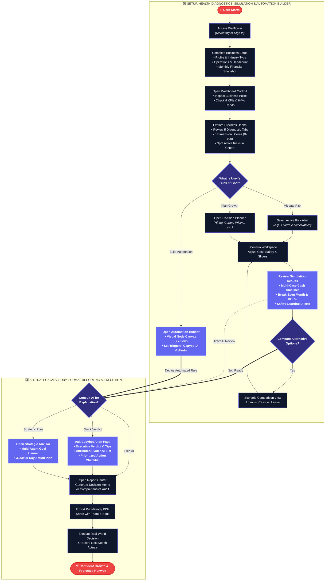
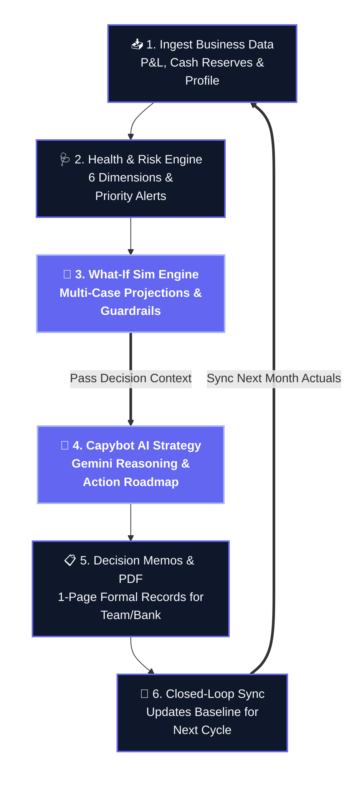

# Wallflower — User Journey & System Workflow Specification

> This document defines the **User Journey** and **System Workflow** of **Wallflower**, derived directly from the active codebase.
> 
> * **User Journey**: Structured in a slide-optimized 2-row layout representing the founder's interactive path.
> * **System Workflow**: Formatted as a **horizontal closed-loop decision cycle** to fit widescreen presentation slides.

---

## 1. User Journey (Slide-Optimized 2-Row Layout)

---

## 2. System Workflow: Closed-Loop Decision Engine (Horizontal Racetrack Oval)

---

## 3. Product Architecture Mapping Reference

| Component in Diagrams | Source of Truth in Codebase | Purpose in Application |
| :--- | :--- | :--- |
| **Business Setup & Snapshot** | `src/features/business-profile/` | Ingests business profile, operations, inventory, and monthly financial snapshots with data quality confidence tags. |
| **Dashboard Cockpit** | `src/features/dashboard/` | Displays real-time Business Pulse status, 4 top KPIs *(Revenue, Runway, Margin, Burn)*, 6-month trends, and prioritized alerts. |
| **Health Diagnostics & Risk Center** | `src/features/business-health/` | Evaluates 6 health dimensions *(Profitability, Liquidity, Solvency, Working Capital, Efficiency, Growth)* and 5 rule-based risk triggers with Baht exposure. |
| **Deterministic Simulation Engine** | `src/features/simulations/engine/` | Calculates multi-case projections *(Expected, Optimistic, Conservative)*, 12-month cash timeline, break-even month, ROI %, and safety guardrails. |
| **Scenario Comparison** | `src/features/simulations/components/compare-simulations-view.tsx` | Aligns multiple scenario outcomes side-by-side *(e.g., Bank Loan vs. Outright Cash vs. Lease)* to evaluate trade-offs. |
| **Automation Workflow Builder** | `src/features/automation/` | Interactive node canvas *(React Flow / XYFlow)* for creating custom automated workflows with triggers, threshold checks, Capybot AI synthesis, auto-simulations, and notification alerts. |
| **Capybot AI Advisor** | `src/features/advisor/` & `src/lib/liquiflow-ai.ts` | Context-aware AI companion powered by Google Gemini 2.5 Flash providing plain-language verdicts, evidence attribution, and action checklists. |
| **Strategic Advisor Workspace** | `src/features/advisor/components/strategic-advisor-workspace.tsx` | Full-page strategic planning center with multi-agent workflow orchestration for 30/60/90-day organizational roadmaps. |
| **Report Center & Decision Memos** | `src/features/reports/` | Compiles verified metrics, multi-case simulations, and AI action roadmaps into 4 executive report blueprints with print-ready PDF export. |
